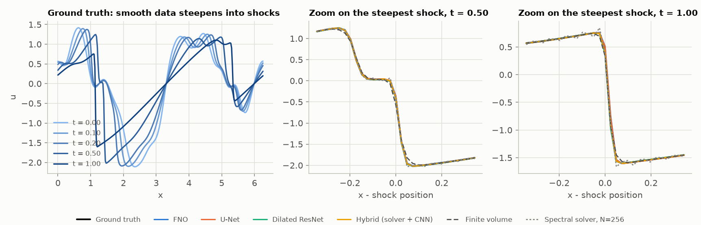
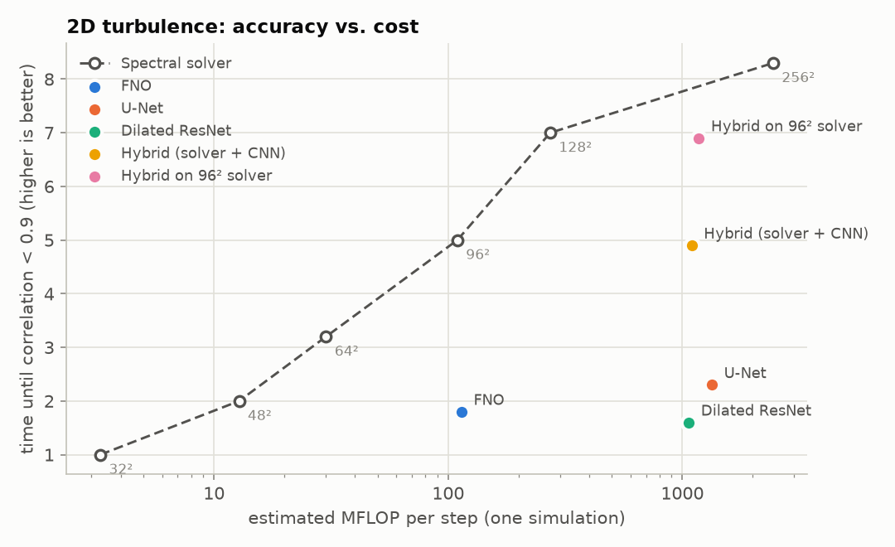
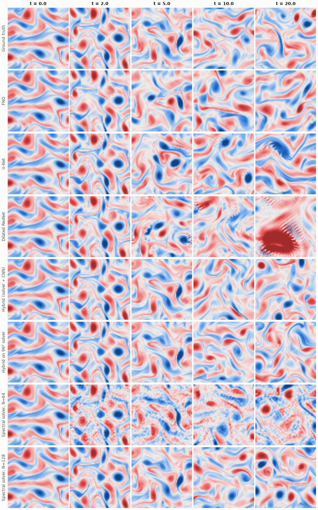
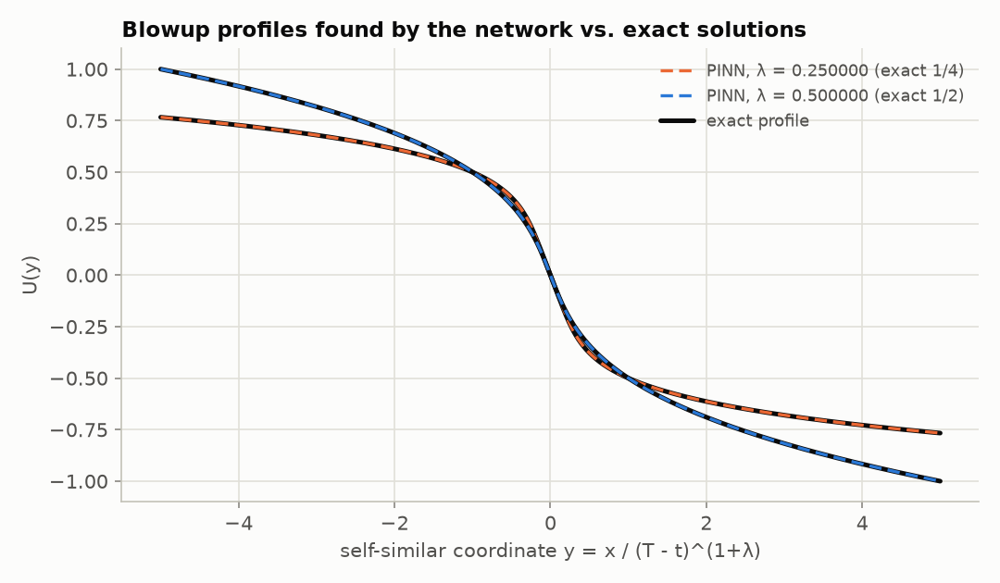

# Phase 1: machine learning playground for Navier-Stokes dynamics

The question for this phase: **can machine-learning models simulate fluid dynamics accurately
(and in a fun way), and which of them are worth carrying into a real-time C++/OpenGL
simulator?** Every model is compared against honest classical baselines that run through
exactly the same code path, because "the neural network is fast" means nothing unless a
simple solver at the same cost is slower or less accurate.

## Results in one minute

| | Burgers shocks (1D) | 2D turbulence (Kolmogorov flow, Re = 1000) |
|---|---|---|
| **Best learned model** | Hybrid (finite volumes + 44k-parameter CNN): **0.16 %** mean error, better than finite volumes on a 4× finer grid | Hybrid on a 96² spectral solver: stays correlated with the truth (> 0.9) for **6.9** time units, vs. 3.2 for a plain 64² solver |
| **Pure neural surrogates** (FNO, U-Net, ResNet) | 0.4-0.8 % error; keep shocks sharp with no spurious oscillations | 1.6-2.3 time units, *worse* than the plain 64² solver, and their enstrophy runs away (up to 7×) in long rollouts |
| **Cheapest way to the same accuracy** | Finite volumes on an 8× grid: 0.10 % at 11.5 MFLOP/step (hybrid: 22 MFLOP) | Spectral solver at 128²: 7.0 time units at 273 MFLOP/step (hybrid-96: 1,177 MFLOP) |
| **Blowup exponents found by a PINN** | stable λ = 1/2 to an error of **1e-11**; unstable λ = 1/4 to **3e-7** | |

**Takeaways**

1. **Learned *corrections* to a solver work; learned *replacements* of a solver don't, at
   least not here.** On its own, a 130k-parameter CNN is worse than the plain 64² solver
   (1.6 vs. 3.2 time units). Give the exact same network a 96² solver step to correct, and
   it matches a 128² solver (6.9 vs. 7.0). The solver supplies stability and physics; the
   network only fixes what the coarse grid misses.
2. **At these sizes, classical refinement is still cheaper in FLOPs.** Each hybrid is worth
   about one rung up the resolution ladder (64² → 96², 96² → 128²), but its CNN costs
   ~1 GFLOP per step, while simply running the spectral solver at 128² costs 0.27 GFLOP.
   ML pays off only with a much lighter corrector, or where refinement is expensive. In 3D,
   doubling resolution costs ~16×, so that is where a hybrid is most likely to earn its
   keep (a hypothesis for Phase 2, not a result yet).
3. **Neural surrogates can invent singularities.** 2D Navier-Stokes cannot blow up, yet the
   pure FNO's enstrophy grew from 10 to 76 over 20 time units, and the ResNet grew a
   spurious vortex blob. For a project *about* blowup, any ML component must stay anchored
   to a solver, or you cannot tell a real singularity from a model failure.
4. **PINNs plus second-order optimisation recover blowup profiles, including an unstable
   one, with high precision** (λ = 1/2 to 1e-11, λ = 1/4 to 3e-7). The 2025 DeepMind
   technique works in miniature. Two details
   decided everything: a Gauss-Newton optimiser (first-order Adam/L-BFGS stalled at a
   residual of ~1e-4) and a residual that probes smoothness at the singular point.

## Experiment 1: Burgers shocks (gradient blowup in 1D)

Viscous Burgers, ν = 0.01, random smooth data. The truth is a 2048-point spectral simulation
coarse-grained to 256 cells; shocks form at t ≈ 0.1-0.3 and then merge. Models step 0.02
time units at a time and are rolled out for 50 steps from the initial state.



| Model | Params | MFLOP/step | Mean rel. L2 error | Steepest gradient at t=0.5 (truth 48.2) |
|---|---|---|---|---|
| Hybrid (FV + CNN) | 43,681 | 22.4 | **0.16 %** | 48.2 |
| Dilated ResNet | 346,305 | 177 | 0.36 % | 48.2 |
| FNO | 608,929 | 13.2 | 0.70 % | 47.9 |
| U-Net | 652,545 | 80.1 | 0.81 % | 48.3 |
| Finite volume, 256 cells | 0 | 0.14 | 1.38 % | 43.6 (smeared) |
| Finite volume, 1024 cells | 0 | 1.8 | 0.26 % | 46.8 |
| Finite volume, 2048 cells | 0 | 11.5 | **0.10 %** | 47.8 |
| Spectral, 256 points | 0 | 0.5 | 1.47 % (Gibbs ringing) | 47.4 |

- Every learned model handles the near-singular fronts better than either classical scheme at
  the same resolution. Finite volumes smear the shock (gradients ~10 % too low); the spectral
  method rings (its total variation rises by up to 2.1, which the true solution never does).
- In FLOPs, the classical ladder still wins: refining the finite-volume grid reaches any of
  these accuracies more cheaply ([cost vs. accuracy](results/burgers/cost_accuracy.png)).
- More figures: [error over time](results/burgers/error.png),
  [steepest gradient](results/burgers/max_gradient.png),
  [total variation](results/burgers/total_variation.png),
  [space-time diagrams](results/burgers/spacetime.png), [animation](results/burgers/rollout.gif).

## Experiment 2: 2D turbulence

Kolmogorov flow (forcing sin 4y, drag 0.1, ν = 10⁻³) on the 2π-periodic square. The truth is a
256² pseudo-spectral simulation (correlation 1.000 with a 512² run over 10 time units),
spectrally truncated to 64². Every model and solver starts from the same 64² state and
rolls out 200 steps of 0.1 time units. The flow is chaotic, so every rollout eventually
decorrelates; the useful metric is **how long it stays correlated (> 0.9) with the truth**.



| Model | Params | MFLOP/step | Corr. > 0.9 until t = | Enstrophy at t = 20 (truth 10.5) |
|---|---|---|---|---|
| Hybrid on 96² solver | 130,369 | 1,177 | **6.9** | 10.3 |
| Hybrid on 64² solver | 130,369 | 1,097 | 4.9 | 10.2 |
| U-Net | 1,949,409 | 1,338 | 2.3 | 16.9 |
| FNO | 2,367,969 | 114 | 1.8 | **76.4** (runaway) |
| Dilated ResNet (same net as the hybrids' corrector) | 130,369 | 1,066 | 1.6 | 22.3 |
| Spectral solver 64² | 0 | 30 | 3.2 | 10.7 |
| Spectral solver 96² | 0 | 109 | 5.0 | 10.7 |
| Spectral solver 128² | 0 | 273 | 7.0 | 10.7 |
| Spectral solver 256² | 0 | 2,442 | 8.3 | 10.3 |



- The 64² solver alone shows the classic under-resolution grain: with 2/3 dealiasing it only
  evolves wavenumbers |k| < 21 of the 32 in the data. The hybrid learns to clean that up.
- The pure models put 6-9× too much energy into the largest scale, the FNO piles energy up
  just above its 12 retained Fourier modes ([spectra](results/ns2d/spectra.png)), and their
  enstrophy drifts upward late in the rollout ([enstrophy](results/ns2d/enstrophy.png)).
- More figures: [correlation over time](results/ns2d/correlation.png),
  [error over time](results/ns2d/error.png), [animation](results/ns2d/rollout.gif).

## Experiment 3: discovering blowup profiles with a neural network

For inviscid Burgers, a singularity at (x, t) = (0, T) looks like
u = (T − t)^λ U(x / (T − t)^(1+λ)). The profile U and exponent λ must satisfy
−λU + ((1+λ)y + U)U′ = 0. Solutions exist for every λ, but they are **smooth only for
λ = 1/2, 1/4, 1/6, …**. λ = 1/2 is the stable, generic blowup; the others are unstable.

A small tanh network represents U (odd, with the normalisations built in) and is trained on
the equation residual. The residual is weighted by 1/y⁵ on log-spaced points near the
origin, so the profile must be smooth through the y⁵ term. Training uses Adam, then
Levenberg-Marquardt in float64.



| Start λ | Learned λ | Error in λ | Max profile error |
|---|---|---|---|
| 0.58 | 0.5000000000 | 1.3e-11 | 6.8e-7 |
| 0.42 | 0.2500002731 | 2.7e-7 | 2.5e-4 |
| 0.15 | 0.2499977035 | 2.3e-6 | 3.9e-4 |
| 0.22 | 0.2499935767 | 6.4e-6 | 3.2e-4 |
| 0.19 | 0.2500177204 | 1.8e-5 | 4.6e-4 |
| 0.29 | 0.2501468797 | 1.5e-4 | 1.8e-2 (not fully converged) |

- **Funnel inference** ([figure](results/selfsimilar/funnel.png)): at fixed λ, the best
  residual is 4e-6 at λ = 1/2 and at least 8e-4 at every other grid point. Learning λ
  jointly with the profile then lands on 1/2 or 1/4.
- **Honest limits.** The dip at λ = 1/4 in the fixed-λ scan is shallow, because the unstable
  profile needs ~4× more optimiser iterations than the scan budget. The funnel around 1/4 is
  also one-sided: just below 1/4, the non-smooth part of the solution behaves like y^(5+),
  which a y⁵ smoothness probe cannot see. A fixed-λ fit at λ = 0.23 still reaches an RMS
  residual of 6e-4, only ~10× above the learned λ = 1/4 solutions. That is also why
  λ = 1/6 is never found; seeing it needs a y⁷ probe. Smoothness must be tested to the
  order of the singularity you are looking for.
- **Why "unstable" matters** ([figure](results/selfsimilar/instability.png)): exact solutions
  by characteristics show that finely tuned initial data blow up with λ = 1/4 all the way
  down to T − t = 1e-12, but a 1e-5 perturbation flips the singularity to λ = 1/2 near
  T − t ≈ 1e-7. An ordinary simulation will essentially never land on an unstable
  singularity, which is why finding them takes this kind of machinery.

## What this means for the real-time C++/OpenGL simulator

- **Build the core on classical solvers.** A pseudo-spectral solver (own radix-2 FFT, no
  libraries) is the most accurate per FLOP for periodic flows: 2D at 128² costs ~0.27 GFLOP
  per 0.1 time units. Use finite volumes (MUSCL + Godunov) wherever shocks or sharp fronts
  appear.
- **Treat ML as an optional enhancement layer, never the engine.** If used, a hybrid
  corrector made only of 3×3 convolutions ports directly to GLSL, but it needs to be at
  least ~7× lighter than ours to pay for itself (fewer channels, one block).
- **Show blowup with setups whose singular behaviour is trustworthy:** (1) 1D Burgers and
  its self-similar zoom (exact via characteristics); (2) 3D vortex stretching (Taylor-Green,
  anti-parallel vortex tubes) while plotting max|vorticity|, the Beale-Kato-Majda
  quantity; (3) the PINN-discovered profiles as precomputed, explorable visualisations.

## Caveats

- One seed per model; training budgets of 8-45 minutes on a laptop GPU that was shared with
  other jobs; 72 training trajectories. Pure surrogates would improve with more data,
  bigger models and tricks such as noise injection or longer unrolls. The conclusions are
  about this budget.
- MFLOP/step counts convolutions and matrix products exactly, FFTs as 2.5·N·log₂N and
  elementwise operations approximately. The PyTorch timings in `results/*/summary.md` are
  at batch size 1, where framework overhead dominates; treat them as noisy.

## Background: what "blowup" means, in five facts

1. **The open problem.** For the 3D incompressible Navier-Stokes equations it is unknown
   whether smooth initial data can develop a singularity (infinite velocity gradients) in
   finite time. This is one of the Clay Millennium Prize problems.
2. **What to watch.** By the Beale-Kato-Majda criterion (1984), a solution blows up at time
   T exactly when the time integral of max|vorticity| diverges as t -> T. A blowup
   simulation is therefore a simulation of runaway vorticity.
3. **Why 2D is safe.** In 2D, vorticity is only carried around and diffused; nothing can
   amplify it, so 2D flows stay smooth forever. Experiment 2 is about learning turbulence,
   not blowup. In 3D, *vortex stretching* can amplify vorticity, which is where blowup
   could happen.
4. **What is known.** Hou & Luo (2014) found numerical evidence of blowup for 3D
   axisymmetric Euler (zero viscosity) at a boundary, and Chen & Hou proved it with
   computer assistance (2022+). Tao (2016) proved blowup for an "averaged" Navier-Stokes
   model. True 3D Navier-Stokes remains open.
5. **Where neural networks come in.** Blowups are often *self-similar*: the solution keeps
   the same shape while shrinking in space and growing in amplitude. Wang, Lai,
   Gómez-Serrano and Buckmaster (2023) used physics-informed neural networks (PINNs) to
   compute such shapes for Euler/Boussinesq. In 2025 a Google DeepMind collaboration used
   high-precision PINNs to discover *unstable* self-similar singularities in several fluid
   models. Unstable ones are thought to be the relevant kind for Navier-Stokes, and they are
   invisible to ordinary simulation. Experiment 3 reproduces that whole story in a setting
   with known exact answers.

## Experiments and models

| # | Experiment | Why it matters for the project |
|---|---|---|
| 1 | **Burgers shocks**: learn the time-stepper of 1D viscous Burgers (ν = 0.01) from random smooth data until shocks form and merge. | Burgers is the textbook 1D cartoon of blowup: without viscosity the slope becomes infinite in finite time. It tests whether models can handle near-singular, under-resolved features. |
| 2 | **2D turbulence**: learn Kolmogorov flow at Re = 1000 on a 64² grid, from 256² direct numerical simulation (DNS). | The standard benchmark for learned fluid simulators (Kochkov et al. 2021). It is chaotic, so it tests accuracy, long-run stability and physical statistics. |
| 3 | **Blowup profiles with a PINN**: a network discovers the self-similar blowup profile *and* the blowup exponent λ of inviscid Burgers, including an unstable one. | A miniature of how DeepMind and collaborators found unstable singularities in fluid equations in 2025. This is the "neural networks meet Navier-Stokes blowup" story for the final web app. |

| Model | Idea | Port to C++/GLSL |
|---|---|---|
| **FNO** (Fourier Neural Operator, Li et al. 2021) | Global convolutions in Fourier space. | Needs an FFT (easy to hand-write for 64² or 256). |
| **U-Net** | Multiscale CNN with skip connections. | Plain convolutions, pooling, upsampling. |
| **Dilated ResNet** (Stachenfeld et al. 2022) | Local 3×3 convolutions with growing dilation. | The simplest: only 3×3 convolutions. |
| **Hybrid** (solver in the loop, Um et al. 2020) | A coarse classical solver step plus a small CNN that corrects what the coarse grid misses. | The solver you would write anyway, plus a small CNN. |

Baselines: the spectral solver at several resolutions (2D), and finite volumes (MUSCL +
Godunov) on several grids plus a spectral solver at the model resolution (Burgers).
Classical solvers keep their own native-resolution state for the whole rollout.

Training is autoregressive: the loss unrolls the model for up to 4 steps and
backpropagates through the whole rollout (the hybrid backpropagates *through the numerical
solver*). Pure one-step training gives models that drift or explode in long rollouts.

## Reproduce

From the repository root:

```bash
python3 -m venv .venv
.venv/bin/pip install -e "ml[dev]"
cd ml
../.venv/bin/python -m pytest                                    # solver + model tests
../.venv/bin/python scripts/generate_data.py burgers             # ~30 s
../.venv/bin/python scripts/generate_data.py ns2d                # ~15-45 min (256² DNS)
../.venv/bin/python scripts/train.py burgers fno unet resnet hybrid --iters 6000
../.venv/bin/python scripts/train.py ns2d fno unet --iters 5000 --batch-size 16
../.venv/bin/python scripts/train.py ns2d resnet hybrid hybrid-96 --iters 3000 --batch-size 16
../.venv/bin/python scripts/evaluate.py burgers                  # add --replot to only redraw
../.venv/bin/python scripts/evaluate.py ns2d
../.venv/bin/python scripts/selfsimilar_blowup.py                # PINN + exact blowup analysis
```

Runs on Apple-silicon GPUs (MPS), CUDA or CPU. Set `NSML_DEVICE=cpu` to force a device.
Datasets (`data/`) and checkpoints (`checkpoints/`) are regenerated by the scripts and are
not committed; `results/` holds the figures, metrics (`metrics.json`) and tables
(`summary.md`) used above.

## Code map

| Path | Contents |
|---|---|
| `nsml/solvers/` | Pseudo-spectral Burgers and 2D Navier-Stokes (integrating-factor RK4, 2/3 dealiasing), MUSCL-Godunov finite volumes. |
| `nsml/data.py` | Dataset definitions (all physical parameters live here) and generation. |
| `nsml/models/` | FNO, U-Net, dilated ResNet; `steppers.py` puts networks, hybrids and solvers behind one interface; `build_stepper()` is the factory. |
| `nsml/train.py` | Unrolled training loop with best-checkpoint selection on validation rollouts. |
| `nsml/evaluate.py` | Rollouts, error/correlation/spectrum/shock metrics, FLOP estimates, timing. |
| `nsml/selfsimilar.py` | Blowup-profile PINN (Levenberg-Marquardt), exact profiles, characteristics analysis. |
| `nsml/plotting.py` | Figures and GIFs. |
